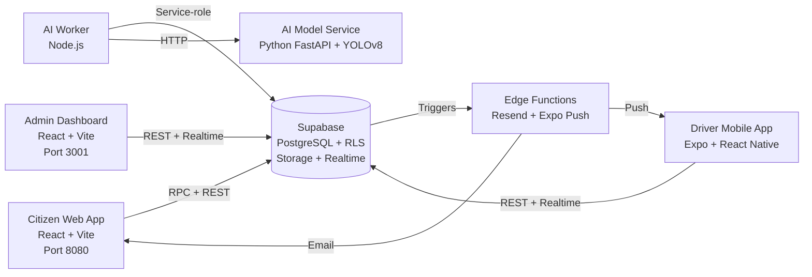

# GrainShield AI

**Government Food Grain Logistics Verification System**  
Gujarat State Civil Supplies Corporation Ltd. (GSCSCL) · SFIC PS000006

---

## Production Status

| Item | Value |
|---|---|
| **Version** | Production RC |
| **Branch** | `main` |
| **Latest commit** | `743a590` |
| **Migrations applied** | 001 – 025 |
| **Database** | Supabase PostgreSQL (hosted) |
| **Apps** | Citizen Web · Admin Dashboard · Driver Mobile |

---

## What is GrainShield AI?

GrainShield AI is a three-application government logistics platform that verifies food grain transport through Gujarat's public distribution supply chain. It uses AI-powered vehicle number-plate recognition and grain detection to ensure authorised vehicles transport grain through every checkpoint — from FCI Mandi to Fair Price Shop.



---

## Architecture

| Layer | Technology |
|---|---|
| Citizen frontend | React 18, Vite, TanStack Router, Tailwind CSS |
| Admin dashboard | React 18, Vite, TanStack Router, Tailwind CSS, Leaflet |
| Driver mobile | Expo 51, React Native, Expo Location (background GPS) |
| Backend | Supabase Auth, PostgreSQL 15, Row-Level Security, Storage, Realtime |
| AI worker | Node.js 20, Supabase JS SDK |
| AI model service | Python 3.11, FastAPI, YOLOv8 (Ultralytics), EasyOCR |
| Notifications | Supabase Edge Functions, Resend (email), Expo Push |

---

## Quick Start

### Prerequisites

- Node.js 20+
- Python 3.11+ (AI model service only)
- Expo CLI (`npm install -g @expo/cli`)
- A Supabase project with migrations 001–025 applied

### Environment Variables

Each app needs a `.env` file. Copy the example and fill in your values:

```bash
# Citizen frontend & Admin dashboard
cp frontend/.env.example frontend/.env
cp apps/admin/.env.example apps/admin/.env

# AI worker
cp ai-worker/.env.example ai-worker/.env
```

**Required variables:**

| App | Variable | Description |
|---|---|---|
| `frontend/` | `VITE_SUPABASE_URL` | Your Supabase project URL |
| `frontend/` | `VITE_SUPABASE_ANON_KEY` | Supabase anon (public) key |
| `apps/admin/` | `VITE_SUPABASE_URL` | Same Supabase project URL |
| `apps/admin/` | `VITE_SUPABASE_ANON_KEY` | Same Supabase anon key |
| `mobile/` | `EXPO_PUBLIC_SUPABASE_URL` | Same Supabase project URL |
| `mobile/` | `EXPO_PUBLIC_SUPABASE_ANON_KEY` | Same Supabase anon key |
| `ai-worker/` | `SUPABASE_URL` | Same Supabase project URL |
| `ai-worker/` | `SUPABASE_SERVICE_ROLE_KEY` | Supabase service-role key (privileged) |
| `ai-worker/` | `CV_PROVIDER` | `http` (production) or `mock` (dev) |
| `ai-worker/` | `CV_API_URL` | URL of the Python AI model service |

### Development

```bash
# 1. Citizen Web App (port 8080)
cd frontend
npm install
npm run dev

# 2. Admin Dashboard (port 3001)
cd apps/admin
npm install
npm run dev

# 3. Driver Mobile App
cd mobile
npm install
npx expo start

# 4. AI Worker
cd ai-worker
npm install
node src/worker.js

# 5. AI Model Service (Python)
cd ai-model-service
pip install -r requirements.txt
uvicorn main:app --host 0.0.0.0 --port 8000
```

### Production Build

```bash
# Citizen frontend
cd frontend && npm run build        # Output: frontend/dist/

# Admin dashboard
cd apps/admin && npm run build      # Output: apps/admin/dist/

# Mobile — EAS Build required for production APK
cd mobile
npm install -g eas-cli
eas build --platform android --profile production
```

---

## Database Migrations

All migrations are in `database/migrations/`. Apply them in order against your Supabase project.

**Apply via Supabase SQL Editor:**

1. Open [Supabase Dashboard](https://supabase.com/dashboard) → SQL Editor
2. Copy-paste each migration file content in order
3. Run each one and confirm it succeeds before proceeding

| Migration | Description |
|---|---|
| `001_initial_schema.sql` | Base schema: trips, users, vehicles |
| `002` – `019` | Incremental schema improvements, indexes, RLS policies |
| `020_audit_logs.sql` | Audit log table and triggers |
| `021_trip_evidence.sql` | Evidence storage with SHA-256 checksum |
| `022_notifications.sql` | Notification queue schema |
| `023_failed_jobs.sql` | Dead-letter queue for AI worker |
| `024_trip_locations.sql` | GPS location tracking with duplicate prevention |
| `025_citizen_trip_rpc.sql` | **REQUIRED** — Automatic Trip ID generation RPC, origin/destination coordinates, commodity |

> [!IMPORTANT]
> Migration 025 **must** be applied before the citizen app will work. Without it, `citizen_create_trip()` does not exist and trip submission will fail.

**Verify migration 025 applied successfully:**

```sql
-- Should return the function
SELECT routine_name FROM information_schema.routines
WHERE routine_name = 'citizen_create_trip';

-- Should return the columns
SELECT column_name FROM information_schema.columns
WHERE table_name = 'trips'
  AND column_name IN ('origin_lat', 'origin_lng', 'destination_lat', 'destination_lng', 'commodity', 'quantity_kg');

-- Should return the unique constraint
SELECT constraint_name FROM information_schema.table_constraints
WHERE table_name = 'trips' AND constraint_name = 'trips_trip_code_unique';
```

---

## Key Features

### Automatic Trip ID Generation

Citizens **never** manually enter a Trip ID. The backend generates a unique, human-readable ID automatically:

**Format:** `GS-YYYY-NNNNNN` (e.g., `GS-2026-000142`)

- Generated by `generate_trip_code()` database function (migration 019)
- Called via `citizen_create_trip()` SECURITY DEFINER RPC (migration 025)
- Globally unique, enforced at the database level
- Retry-safe — concurrent submissions are handled with a retry loop
- Returned to the citizen on the confirmation screen

### AI Verification Pipeline

1. Citizen uploads a vehicle photograph
2. AI worker polls for `pending` verification jobs
3. AI model service (YOLOv8 + EasyOCR) detects and reads the number plate
4. Result is `pass`, `retake`, or `manual_review`
5. Citizen is notified via Supabase Realtime

### GPS Tracking

- Driver mobile app tracks GPS in the background (Expo Location)
- Locations are stored with timestamps in `trip_locations`
- Admin live-tracking map shows current driver position
- Stale GPS warnings appear when last location is > 10 minutes old
- Duplicate locations within 30 seconds are discarded

### Gujarati Localisation

The citizen web app supports English and Gujarati:
- Language toggle in the app header (English ↔ ગુજરાતી)
- Language preference persists in localStorage
- 90+ translated strings covering all major UI elements

---

## Production Reports

The following compliance and audit documents are in the repository root:

| Document | Description |
|---|---|
| [`GRAINSHIELD_FINAL_PROJECT_AUDIT.md`](./GRAINSHIELD_FINAL_PROJECT_AUDIT.md) | Full codebase and architecture audit |
| [`GRAINSHIELD_FINAL_REQUIREMENTS.md`](./GRAINSHIELD_FINAL_REQUIREMENTS.md) | Formal requirements specification |
| [`GRAINSHIELD_BUTTON_FUNCTIONALITY_MATRIX.md`](./GRAINSHIELD_BUTTON_FUNCTIONALITY_MATRIX.md) | Every button/form/link verified |
| [`GRAINSHIELD_AI_ACCURACY_REPORT.md`](./GRAINSHIELD_AI_ACCURACY_REPORT.md) | AI model evaluation (honest — no fabricated metrics) |
| [`GRAINSHIELD_GPS_PHYSICAL_DEVICE_TEST_REPORT.md`](./GRAINSHIELD_GPS_PHYSICAL_DEVICE_TEST_REPORT.md) | GPS testing procedure and results |
| [`GRAINSHIELD_SECURITY_AUDIT.md`](./GRAINSHIELD_SECURITY_AUDIT.md) | Security audit: RLS, auth, evidence integrity |
| [`GRAINSHIELD_END_TO_END_TEST_REPORT.md`](./GRAINSHIELD_END_TO_END_TEST_REPORT.md) | End-to-end test results |
| [`GRAINSHIELD_DATABASE_MIGRATION_REVIEW.md`](./GRAINSHIELD_DATABASE_MIGRATION_REVIEW.md) | Migration review and rollback procedures |
| [`GRAINSHIELD_DEPLOYMENT_GUIDE.md`](./GRAINSHIELD_DEPLOYMENT_GUIDE.md) | Step-by-step production deployment |
| [`GRAINSHIELD_PRODUCTION_READINESS_CHECKLIST.md`](./GRAINSHIELD_PRODUCTION_READINESS_CHECKLIST.md) | Go/No-Go checklist |
| [`GRAINSHIELD_PERFORMANCE_TEST_GUIDE.md`](./GRAINSHIELD_PERFORMANCE_TEST_GUIDE.md) | k6/Artillery load tests, Lighthouse targets |
| [`GRAINSHIELD_BACKUP_DR_GUIDE.md`](./GRAINSHIELD_BACKUP_DR_GUIDE.md) | Backup schedule, PITR, disaster recovery |

---

## Security

- All data access is enforced by **Row-Level Security (RLS)** at the database level
- Citizens can only read and write their own trips
- Drivers can only access trips assigned to them
- The service-role key is used only by the AI worker (never exposed to the browser)
- Evidence files are stored with SHA-256 checksums to detect tampering
- All sensitive actions are logged in `audit_logs`
- Trip IDs are generated by the backend only — never accepted from client input

> [!CAUTION]
> Never expose `SUPABASE_SERVICE_ROLE_KEY` to the browser or mobile app. This key bypasses all RLS policies.

---

## Repository Structure

```
GrainShield-AI/
├── frontend/              # Citizen Web App (React + Vite)
├── apps/admin/            # Admin Dashboard (React + Vite)
├── mobile/                # Driver Mobile App (Expo + React Native)
├── ai-worker/             # AI Job Worker (Node.js)
├── ai-model-service/      # AI Model Service (Python FastAPI + YOLOv8)
├── supabase/
│   └── functions/         # Edge Functions (notifications)
├── database/
│   └── migrations/        # 001–025 SQL migration files
├── GRAINSHIELD_*.md       # Production compliance documents
└── README.md
```

---

## Contributing

1. Never apply database migrations to production without explicit authorization.
2. Run TypeScript checks before committing: `npx tsc --noEmit`
3. Run Prettier before committing: `npx prettier --write "src/**/*.{ts,tsx}"`
4. All new features require a migration file (if DB changes are needed).
5. Do not introduce duplicate Trip ID systems.
6. Preserve all existing audit logs and evidence records.

---

## Licence

Internal government project — GSCSCL / Gujarat Government use only.  
Not for public distribution.

---

*GrainShield AI — Securing Gujarat's food grain supply chain through AI-powered verification.*
